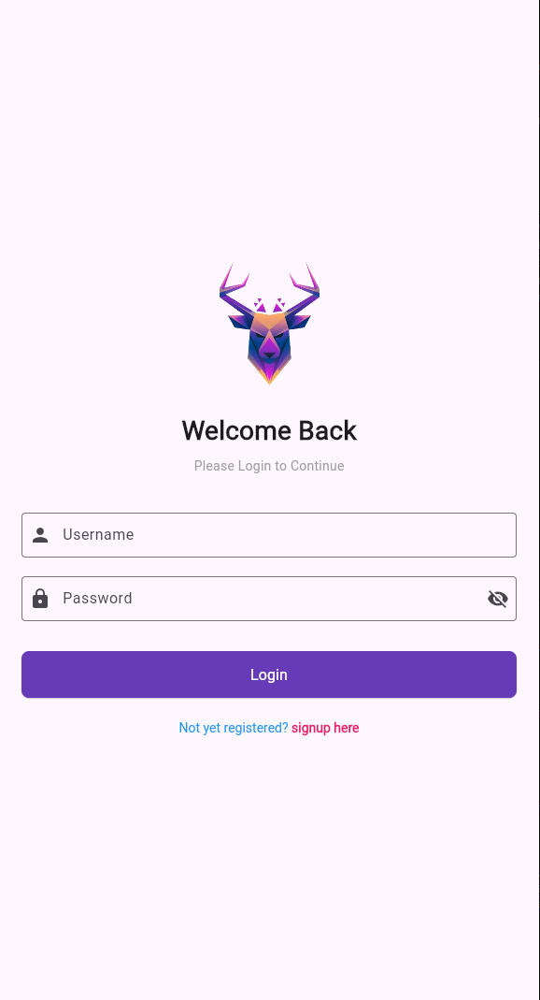
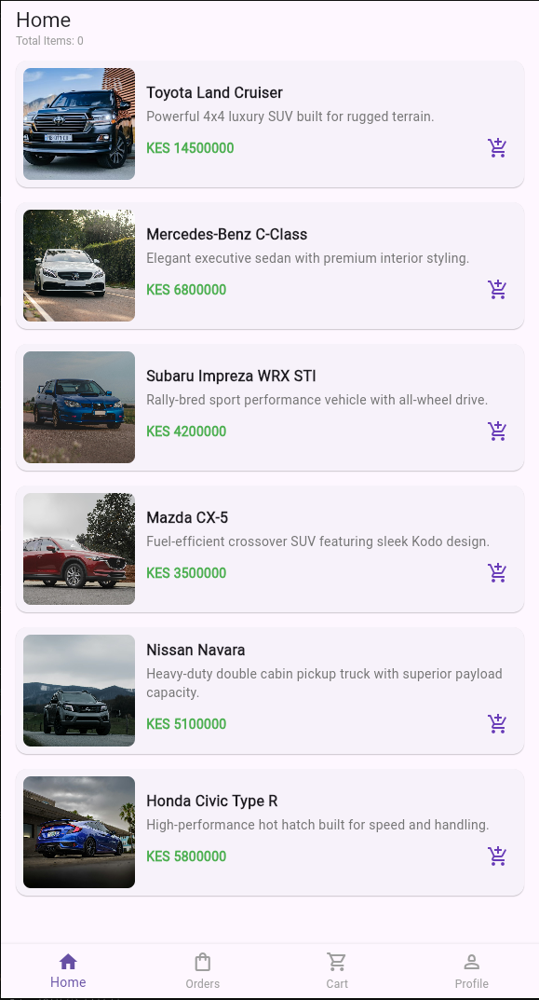
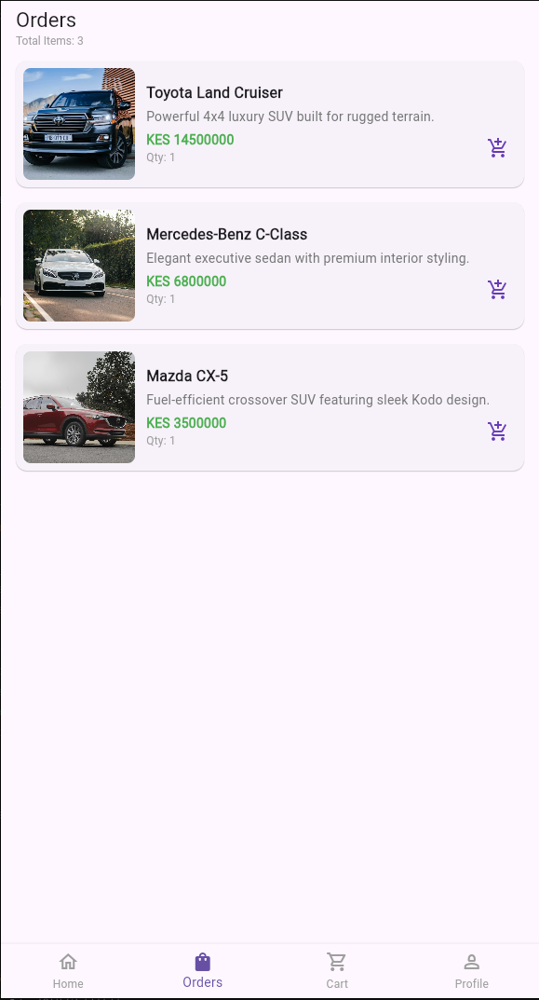
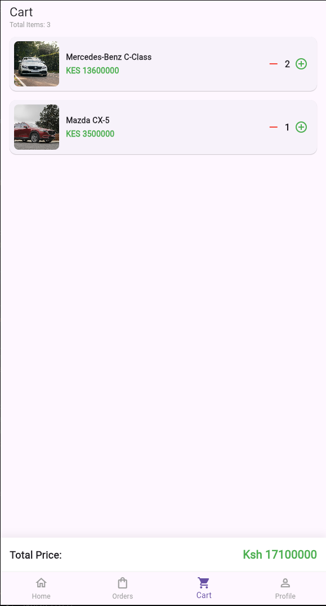
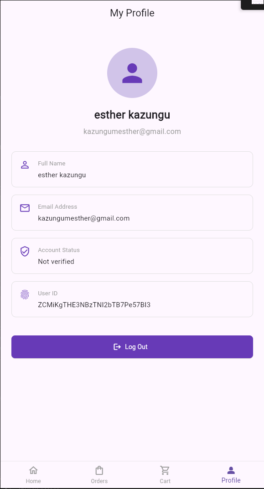

# Motorly 
### Find your drive. Own your journey.

Motorly is a Flutter-based car shopping application that provides users with a simple way to explore vehicles, select cars, and manage their shopping cart.

The application features Firebase-powered authentication, vehicle browsing, cart management, and user profile functionality.

## Features

- **User Registration:** Create an account using an email address and password.
- **User Login:** Securely sign in using Firebase Authentication.
- **Vehicle Browsing:** Explore available vehicles on the home screen.
- **Shopping Cart:** Add vehicles to the cart and manage selected items.
- **Orders Section:** Access the Orders section from the main navigation.
- **User Profile:** View account details and log out.
- **Navigation:** Easily switch between Home, Orders, Cart, and Profile.

## Application Screenshots

### Login Screen


### Sign Up Screen


### Home Screen


### Orders Screen


### Shopping Cart


### Profile Screen


## Built With

- **Flutter** – Cross-platform application development.
- **Dart** – Programming language.
- **Firebase Authentication** – User registration and login.
- **Firebase Core** – Firebase initialization.
- **Provider** – State management.
- **Material Design** – User interface components.

## Project Structure

```text
lib/
├── model/
│   ├── auth-exception.dart
│   ├── cart.dart
│   ├── product.dart
│   └── ...
├── screens/
│   ├── login_screen.dart
│   ├── signup_screen.dart
│   ├── home_screen.dart
│   ├── card_cart.dart
│   ├── profile_screen.dart
│   └── ...
├── services/
│   └── auth_api.dart
├── view_model/
│   └── auth_view.dart
├── firebase_options.dart
└── main.dart

screenshots/
├── login.png
├── signup.png
├── home.png
├── orders.png
├── cart.png
└── profile.png
```

## Getting Started

### Prerequisites

Before running Motorly, make sure you have:

- Flutter SDK installed.
- Dart SDK installed.
- Android Studio or Visual Studio Code.
- A Firebase project.

### Installation

1. Clone the repository:

   ```bash
   git clone YOUR_GITHUB_REPOSITORY_URL
   ```

2. Navigate to the project directory:

   ```bash
   cd motorly
   ```

3. Install the dependencies:

   ```bash
   flutter pub get
   ```

4. Configure Firebase for your project:

   ```bash
   flutterfire configure
   ```

5. Enable the Email/Password sign-in provider in Firebase Console.

6. Run the application:

   ```bash
   flutter run
   ```

## Firebase Authentication

Motorly uses Firebase Authentication to manage user accounts.

Users can:
- Register with their first name, last name, email, and password.
- Sign in using their email and password.
- Log out of their accounts.

## Future Improvements

- Search vehicles by make and model.
- Filter vehicles by price, brand, and year.
- View detailed vehicle specifications.
- Save favourite vehicles.
- Compare available vehicles.
- Book test drives.
- Integrate secure vehicle checkout and payment functionality.

## Author
Esther Kazungu
Developed using Flutter and Firebase.
